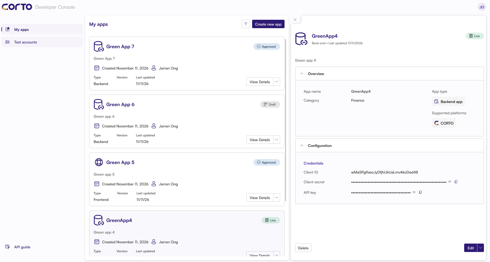

Backend apps let your server or machine-to-machine (M2M) application call the [Corto public APIs ](https://docs.docorto.ai/docs/api/72b66de24898e-introduction)on behalf of your firm and its users.

## Credentials

When you create a backend app, the Developer Console generates three credentials:

- **Client ID**
- **Client secret**
- **API key**

To view them, open the app from **My apps** and expand **Configuration**.

<Warning>
  Keep your client secret and API key private. Store them in environment variables or a secrets manager, and never include them in client-side code or public repositories.
</Warning>

## Create a backend app

<Steps>
  <Step title="Start a new app">
    In the Developer Console, go to **My apps** and click **Create new app**.
  </Step>
  <Step title="Choose the app type">
    Select an environment, select **Backend app**, then click **Create new app**.
  </Step>
  <Step title="Copy your credentials">
    Open the app and copy the client ID, client secret, and API key from **Configuration**.
  </Step>
  <Step title="Call the Corto APIs">
    Use your credentials to authenticate with the Corto public APIs. See the Getting Started sections in the documentation [here](https://docs.docorto.ai/docs/api/72b66de24898e-introduction)
  </Step>
</Steps>

<Card title="Corto API reference" icon="code" href="https://docs.docorto.ai/docs/api/72b66de24898e-introduction">
  Browse the available endpoints and authentication details.
</Card>
