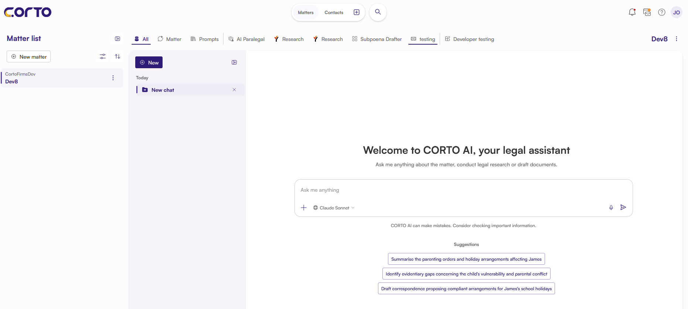

Frontend Applications add actions to the Corto interface. When a user clicks one of your actions, Corto opens the URL you configured for it.

## Where actions appear

You can add one or more actions to a Frontend Application. Each action appears in one of two locations:

| Location | Where users see it |
| --- | --- |
| Firm level | In the top navigation, next to **Matters** and **Contacts**. |
| Matter level | In the header of a matter's chat. |

Firm level:

Matter level:

## Create a Frontend Application

<Steps>
  <Step title="Start a new Application">
    In the Developer Console, go to **My apps** and click **Create new app**.
  </Step>
  <Step title="Choose the Application type">
    Select an environment, select **Frontend app**, then click **Create new app**.
  </Step>
  <Step title="Add actions">
    For each action, set its location and the URL it opens.
  </Step>
  <Step title="Submit for review">
    When you're ready, submit the Application for review. See the [Quickstart](/quickstart) for the full publishing process.
  </Step>
  <Step title="Use your actions in Corto">
    Once your Application is approved and you select **Set live**, its actions appear in the Corto interface, ready to use.
  </Step>
</Steps>
