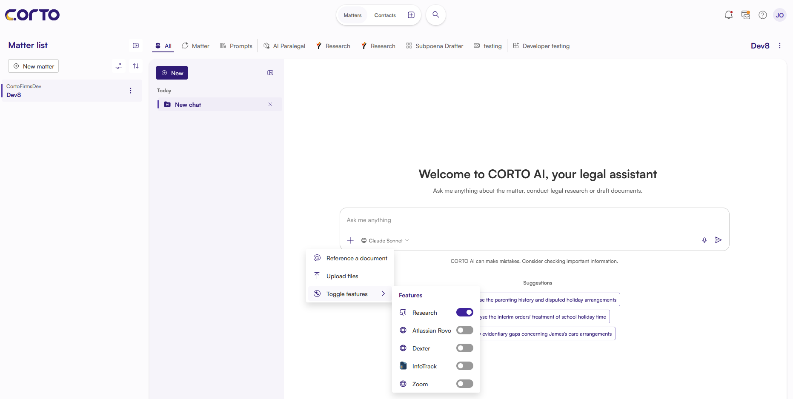

MCP apps expose tools and data from your server so that Corto AI can call them on behalf of a user during a chat.

## Create an MCP app

<Steps>
  <Step title="Start a new app">
    In the Developer Console, go to **My apps** and click **Create new app**.
  </Step>
  <Step title="Choose the app type">
    Select an environment, select **MCP only**, then click **Create new app**.
  </Step>
  <Step title="Submit for review">
    When you're ready, submit the app for review. See the [Quickstart](/quickstart) for the full publishing process.
  </Step>
</Steps>

## How users connect to your app

Once your app is installed, users connect to it from their Corto settings and then turn it on in chat.

<Steps>
  <Step title="Connect the app">
    In Corto, open the account menu and select **Account settings**. Go to **Integrations** and click **Connect** next to your app.

    
  </Step>
  <Step title="OAuth flow">
    This will popup a screen where the User will want to signup with their email to authenticate and authorize the requested system.
  </Step>
  <Step title="Turn it on in chat">
    In a chat, click **\+**, select **Toggle features**, and turn on your app.

    
  </Step>
  <Step title="Begin chatting">
    Start chatting with the confidence that the connected MCP Server can utilize their applicable knowledge base.
  </Step>
</Steps>
