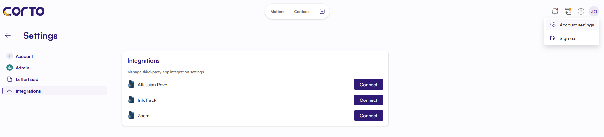

MCP Apps that apply their knowledge on the LLM chat.

- On creation of an MCP app, users will be able to connect to it and use it for the LLM chat.
- Once installed, a Connect option for the MCP app will appear in the User Settings > Integrations tab.
- After connecting, Users can toggle it for their chat.

