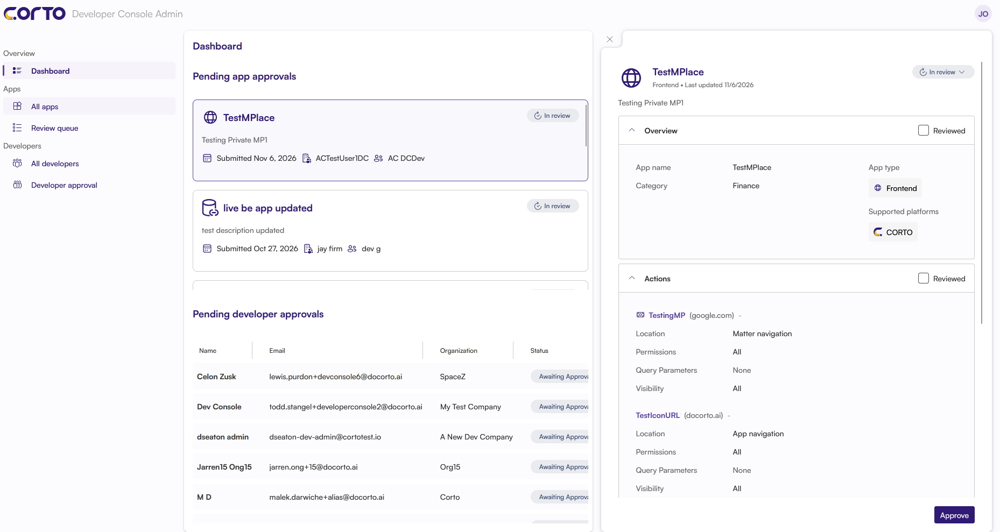

User guide for Admins

- Login to [https://admindeveloperconsole.dev.docorto.ai/](https://admindeveloperconsole.dev.docorto.ai/)
  - If you do not have an account already, Sign Up and contact the Corto Backend team to set your User to an "Active" state in the underlying Auth0 system.
- Approve as necessary

