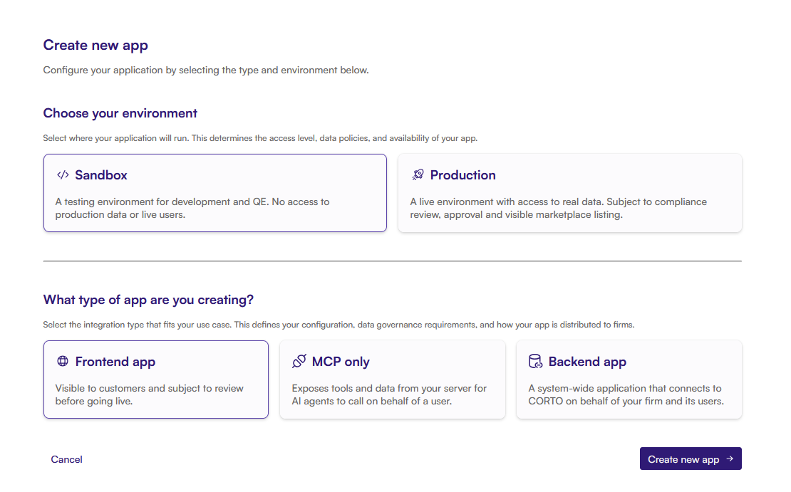

This guide walks you through signing up for the Corto Developer Console, creating an app, and publishing it to the Corto Marketplace.

## Create and publish an app

<Steps>
  <Step title="Sign up">
    Create an account at [developerconsole.dev.cortoaws.com](https://developerconsole.dev.cortoaws.com). A Corto admin reviews and approves new developer accounts before you can start building.
  </Step>
  <Step title="Create an app">
    From **My apps**, click **Create new app**. Choose an environment and an app type, then click **Create new app**.

    - **Sandbox**: for development and testing. Sandbox apps stay in draft and don't need approval. Use them with [test accounts](/test-accounts) to try your integration in Corto before going to production.
    - **Production**: for live use with real data. Production apps go through review and, once published, are listed in the Marketplace.

    See [Frontend](/auth/apps/frontend), [Backend](/auth/apps/backend), and [MCP](/auth/apps/mcp) apps for details on each type.

    
  </Step>
  <Step title="Submit for review">
    When your draft is ready, click **Submit for review**. The app's status changes from **Draft** to **In review**.
  </Step>
  <Step title="Wait for approval">
    A Corto admin reviews your app. Once approved, its status changes to **Approved**.
  </Step>
  <Step title="Set your app live">
    Open the menu next to **View details** and select **Set live**. The app's status changes from **Approved** to **Live**.

    <Warning>
      Setting an app live applies all of your draft changes to the published app. Schedule this step for a planned release time.
    </Warning>

    
  </Step>
</Steps>

## App statuses

| Status | Meaning |
| --- | --- |
| Draft | You're still editing the app. |
| In review | The app is waiting for a Corto admin to review it. |
| Approved | The app has been approved and is ready for you to set live. |
| Live | The app is published and available to firms. |
