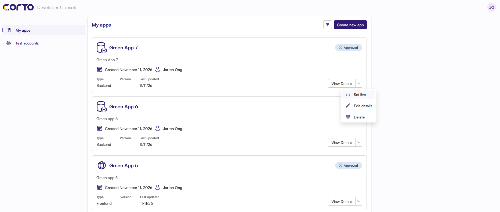

- Sign up via [https://developerconsole.dev.cortoaws.com](https://developerconsole.dev.cortoaws.com)
- An Admin will then review and approve your application.
- Create an Application.
  - Sandbox Applications will be in Draft but do not require Approval. These will work with Test Accounts to try out the integration in Corto ahead of time.
  - Production Applications will go through Drafts but on Approval → Publish, will be visible in the Marketplace.
  - See /Applications for the types of Applications currently available.

- Once the Application Draft is in a ready state, hit Submit For Review. Your Application will move from [Draft] → [In Review].
- An Admin will review and approve it. This moves your Application from [In Review] → [Active].
- Now the control is back over to you. You can now hit Set live to move the Application from [Approved] to [Live]. Note that this will apply your Draft changes to the Application so do ensure this deployment happens at a planned time.

