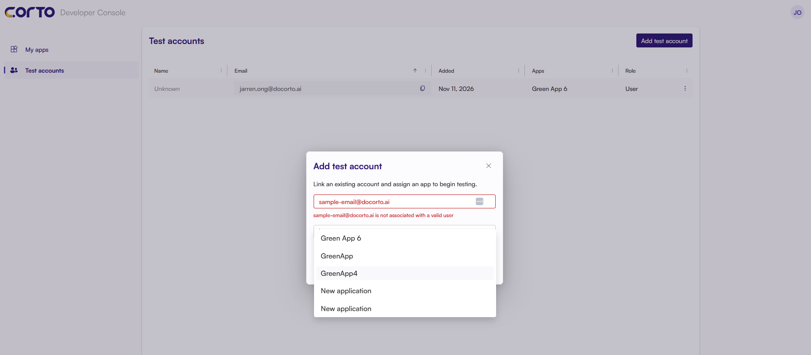

Test accounts let you try a sandbox app inside Corto before you submit it for production.

## Before you begin

The user you want to test with must already have an account on Corto, LawY, or AccTivity. If they don't have a Corto account, they can sign up at [home.dev.docorto.ai/signup](http://home.dev.docorto.ai/signup).

## Add a test account

<Steps>
  <Step title="Open Test accounts">
    In the Developer Console sidebar, select **Test accounts**.
  </Step>
  <Step title="Connect an email">
    Enter the user's email address and connect it to the sandbox app you want to test.
  </Step>
  <Step title="Apply Roles">
    Modify the Test Account to apply Roles where necessary.
  </Step>
  <Step title="Test in Corto">
    Sign in to Corto as that user to try your app.
  </Step>
</Steps>

<Note>
  Test accounts work with sandbox apps only.
</Note>

